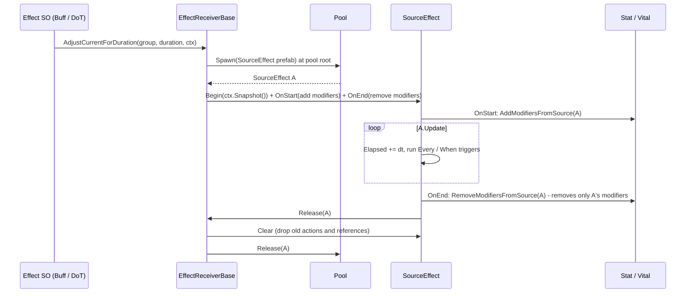
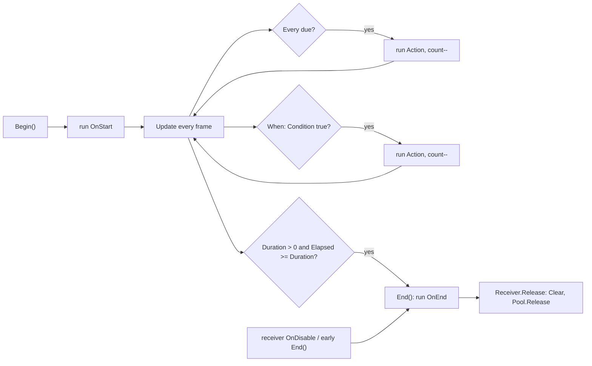

# Effect Source Plan — one `SourceEffect` object per applied effect

> **Status:** Proposed, not implemented. Saved 2026-10-27 on `feature/add-effect-component` (HEAD `6e484f0c`).
> **Scope:** Abilities v2 stat effects, `IEffectReceiver`, and per-cast state on effect ScriptableObjects.
> All findings below are static analysis against source and asset YAML; none has been observed in Play Mode.

## 1. Context

1. **Null source.** `BuffDebuffStatsForDuration` → `EffectReceiverBase.AdjustCurrentForDuration()` adds modifiers
   with `source = null`. When one buff expires, `RemoveModifiersFromSource(null)` (`BaseStatsSO.cs:168`, matched by
   `ReferenceEquals`) strips **every** null-source modifier, including other buffs that are still running.
2. **Stat effects never run.** `PlayerEffectReceiver` / `EntityEffectReceiver` derive from `MovementBase` instead of
   `EffectReceiverBase`, and neither is on any prefab or scene. `TryGetRecipientComponent<IEffectReceiver>` always
   returns false, so every stat effect is a silent no-op.
3. **Per-cast state lives on shared ScriptableObjects.** `SpawnEffectBase._context`, `SpawnProjectileEffect.dir`,
   `BuffDebuffStatsForDuration.effectReceiver` and `StatModifierEffect.effectReceiver` are fields on assets. A
   ScriptableObject is one shared instance for every character that uses it, so these fields are effectively
   global. They are redundant: every entry point (`TryCast`, `Apply`, the hit callbacks) already receives the
   context as a parameter; `_context` exists only because `Angle()` / `SpawnPos()` take no parameters. Safe today
   (write and read happen in one synchronous call, callbacks use their parameter, and no two casters share an
   asset yet), but it fails silently as soon as an enemy shares an ability, a delay is added, or effects nest.

### Decisions (owner)

- **Each time an effect is applied to a character, one `SourceEffect` object represents it** (MonoBehaviour, one
  prefab, pooled). That object is the running effect and also the source used to add and remove its impacts.
- **One class only; per-effect logic is attached through `Action<SourceEffect>`**, and the object runs those
  actions itself when their condition is met.
- **The receiver creates and owns the `SourceEffect`.** The caster only supplies identity through
  `AbilityContext`, and the `SourceEffect` keeps a **copy** of that context.
- The cleanup of per-cast fields on effect ScriptableObjects is part of this plan.
- Out of scope for now: stacking policies, handle/generation ids, subclasses per effect type.

### Industry reference (summary)

| System | Per-application object | Removal | Stacking |
|---|---|---|---|
| Unreal GAS | `FActiveGameplayEffect` in the ASC's active container, returned as `FActiveGameplayEffectHandle` | by handle; by source effect + instigator | None / AggregateBySource / AggregateByTarget |
| Dota 2 | modifier instance on the unit (caster, ability, duration, stacks) | by name; on expiry | stack count on the instance |
| Unity stat systems (Kryzarel and derivatives) | `StatModifier.Source` (`object`) | `RemoveAllModifiersFromSource` | custom |

All of them separate the definition (shared asset) from a per-application instance, and use that instance as the
single source for every subsystem. This plan follows the same shape, with the instance being a pooled
`SourceEffect`.

## 2. Diagrams

### 2.1 Lifecycle of one `SourceEffect`

### 2.2 Trigger evaluation inside `SourceEffect`

### 2.3 What the effect reads from `AbilityContext`

`AbilityContext` is created once per cast (`AbilityInstance.BuildContext()` inside `CanStart()`) and shared by every
effect and spawned object of that cast. Identity fields (`Caster`, `Origin`, `Forward`, `DirectionIndex`,
`TargetPoint`, `AbilityInstance`, `AbilityDefinition`, `Services`) are written once. `Target` is overwritten on every
hit and `Recipient` per effect. `SourceEffect` therefore stores `ctx.Snapshot()` (a shallow copy), never the shared
reference. Item effects have no context and pass an instigator object instead.

## 3. Changes

### 0. Restore modifier data (do first)
`Assets/Script/System/StatSystem/StatModifier.cs`: `6e484f0` renamed `targetStat` → `targetStatType` without
`[FormerlySerializedAs]`. 18 assets (`SnS_Stat`, the Paladin effects, character stat assets, item effects) still store
`targetStat:`, so every modifier currently loads as STR. Fix:
`[SerializeField, FormerlySerializedAs("targetStat")] private StatType targetStatType;`
(add `using UnityEngine.Serialization;`).

### A. Remove per-cast state from effect ScriptableObjects (no behaviour change)
- `Abilities/Effects/SpawnEffectBase.cs`: delete `_context`. Add
  `protected void Spawn(SpawnMono prefab, AbilityContext ctx, Action<AbilityContext> callback)` that computes a local
  `dir` → `angle` → `SpawnPos(ctx, dir)` → `ctx.Services.Pool.Spawn(...)` → `Launch(Lifetime, ctx, callback)`.
  `Apply(ctx)` calls `Spawn(Prefab, ctx, Execute)`. New abstract signatures:
  `Vector2 Direction(AbilityContext ctx)`, `Vector2 SpawnPos(AbilityContext ctx, Vector2 dir)`. Delete the old
  commented-out lines.
- `SpawnProjectileEffect.cs`: delete the `dir` field; `Direction(ctx)` returns `ctx.Forward` normalised
  (fallback `Vector2.right`); `SpawnPos(ctx, dir) = ctx.Origin + dir * SpawnOffset`.
- `SpawnSummonEffect.cs`: `Direction(ctx) = Vector2.right` (angle 0, as today); `SpawnPos(ctx, _) = ctx.TargetPoint`;
  `TryCast` calls `Spawn(Prefab, ctx, Execute)` (telegraph); `Apply` calls `Spawn(summonPrefab, ctx, SummonExecute)`.
  Both paths now work the same way.
- `BuffDebuffStatsForDuration.cs`: `effectReceiver` becomes a local in `Apply()`.
- `Item/ItemEffectDefinition/StatModifierEffect.cs`: `effectReceiver` becomes a local.
- `SpawnMono.cs`: add `OnDisable()` that sets `_context = null; _callback = null`, so pooled objects do not hold an
  old context.

### B. `SourceEffect : MonoBehaviour` (new)
`Assets/Script/System/Abilities/Runtime/SourceEffect.cs` + a `SourceEffect` prefab (empty GameObject with the script).
- Data: `Receiver`, `Definition`, `Context` (snapshot, null for items), `Instigator` (`Context?.Caster`, or the object
  an item passes), `Duration` (≤ 0 = no expiry), `Elapsed`, `IsRunning`.
- `EffectTrigger` (same file): `Condition`, `Action`, `RemainingCount` (-1 = unlimited), `Interval`, `NextTime`.
- API: `Begin(receiver, definition, context, duration, instigator = null)`, `OnStart(Action)`,
  `Every(interval, count, Action)`, `When(condition, Action, count = 1)`, `OnEnd(Action)`, `End()`, `Clear()`.
- `Update()`: advance `Elapsed`, run triggers that are due or whose `Condition` holds, call `End()` when `Duration`
  is reached.
- `End()`: run every `OnEnd` once, then `Receiver.Release(this)`. `Clear()` drops triggers and all references before
  the object returns to the pool.
- `AbilityContext.Snapshot()` (new, `AbilityContext.cs`): `(AbilityContext)MemberwiseClone()`.

### C. `IEffectReceiver` / `EffectReceiverBase`
- `IEffectReceiver`: the last parameter of the four `Adjust…` methods changes from `object obj` to
  `AbilityContext context` (items use an overload that passes `null` plus an instigator). Add
  `void Release(SourceEffect effect)` and `void RemoveByInstigator(object instigator)`.
- `EffectReceiverBase.cs`:
  - `[SerializeField] SourceEffect sourceEffectPrefab`; `[Inject] Construct(IObjectPoolService pool)`;
    `List<SourceEffect> activeEffects` + `IReadOnlyList<SourceEffect> ActiveEffects`.
  - `CreateEffect(definition, context, duration, instigator)`: `pool.Spawn(prefab, transform.position, identity)`
    with **no parent**, so the object sits at the pool root. An enemy returning to the pool is deactivated, and
    releasing a child inside the parent's `OnDisable` raises "Cannot change GameObject hierarchy while activating or
    deactivating the parent"; a deactivated child would also stop its timer. Then `Begin(...)` and add to the list.
  - `Release(effect)`: only if still in the list; remove it, `Clear()`, `pool.Release`.
  - `RemoveByInstigator(instigator)`: `End()` every effect whose `Instigator` matches.
  - `protected virtual void OnDisable()`: `End()` every remaining effect (`CoreComponentBase` has no `OnDisable`).
  - `AdjustCurrentForDuration`: if `duration <= 0`, `Debug.LogWarning` and skip (Avatar of Light's
    `Gain For Time Effect` has `duration: 0` and must not become a permanent buff). Otherwise `OnStart` →
    `statHandler.AddModifiersFromSource(e, group.Modifiers)`, `OnEnd` → `RemoveModifiersFromSource(e)`.
  - `AdjustMaxToCurrentStats`: amount = `Mathf.Abs(modifier.Value)` for Flat; for PercentAdd / PercentMult,
    `Mathf.Abs(value) * statHandler.GetStatValue(stat)`. Fixes the sign bug (a negative value healed) and the
    PercentAdd bug (0.15 healed 0.15 HP).
  - `AdjustCurrentPerTimeForDuration`: `Every(perTime, count, e => AdjustMaxToCurrentStats(group))` with
    `duration = perTime * count`. Replaces `NotImplementedException` and the recursive coroutine.
  - `AdjustMaxStats` (permanent item buff): `duration = 0`, `OnStart` adds and `OnEnd` removes the modifiers.
  - Delete `effectSource = new GameObject()` (a leak), `SetEffectSource()` and the unused `currentStats`.
- Callers: `BuffDebuffStatsForDuration` passes `context`; `RecoveryReductionPerTimeForDuration` and
  `RecoveryReductionStatsEffect` pass `context` instead of `context.Caster`.

### D. Attach real receivers
- `PlayerEffectReceiver : EffectReceiverBase<Core>`, `EntityEffectReceiver : EffectReceiverBase<EntityCore>`.
- Add the component to the player prefab and every enemy prefab (child of Core) and assign `sourceEffectPrefab`.

## 4. Impact analysis

- **Callers of `IEffectReceiver`:** three (`BuffDebuffStatsForDuration:13`, `RecoveryReductionStatsEffect:8`,
  `RecoveryReductionPerTimeForDuration:11`). Items do not call it yet.
- **Serialized data:** the removed SO fields are not serialized (`protected`/`private`, no `[SerializeField]`), so no
  asset changes. Step 0 restores data that is currently being lost.
- **Injection:** the player is created by `resolver.Instantiate`, and new pooled enemies are injected by
  `Pool.Spawn` (`Pool.cs:31`), so `[Inject] Construct` on the receiver runs for both.
- **Visible behaviour change:** stat effects start working. Current data:

| Ability | Effect asset | Data | After this plan |
|---|---|---|---|
| Blessed Slash | `Paladin Recovery Reduction Stats Effect` | HP Flat +30 | heals the caster 30 HP per use |
| Blessing | `Paladin Recovery Reduction Stats Effect` | HP PercentAdd 0.15 | heals 15% of max HP |
| Blessing | `Paladin Buff - Debuff Stat Effect` | PhysicalDamage +15%, Defense +15%, 3 s | 3 s buff, removed independently |
| Avatar of Light | `Gain For Time Effect` | HP Flat +15, `duration: 0` | skipped with a warning until `duration` is set |
| Avatar of Light | `Recovery Stat Effect` | no modifiers | no effect |

- **Not covered:** stacking policy, handle/generation, slow/stun through `IMovement`, the ability animation issues
  (`DoAB` never reset, player animator controller not restored), BUG-083 (`HoldRatio` always 0), and the
  `Rain Arrows` ability pointing at the Consecrate spawn effect.

## 5. Verification (Play Mode; no test runner yet, BUG-084)

1. `SnS_Stat.asset` shows STR +2 and PhysicalDamage +10 in the Inspector; the Blessing buff shows PhysicalDamage and
   Defense.
2. Blessed Slash heals 30 HP; Blessing heals 15% max HP; Avatar of Light logs the `duration <= 0` warning and adds
   nothing permanent.
3. Spawn behaviour unchanged: Blessed Slash flies toward the mouse and spawns `SpawnOffset` from the caster;
   Consecrate shows the telegraph during Cast and the strike during Do, at the mouse position.
4. Blessing cast twice, overlapping: two `SourceEffect` objects exist; when the first expires only its modifiers are
   removed.
5. Item buff, then Blessing: when Blessing expires the item buff remains.
6. DoT with `perTime = 1, timeCount = 3`: exactly 3 ticks, 1 s apart, then the object returns to the pool.
7. A `SourceEffect` reused from the pool never runs a previous action.
8. Killing an enemy that carries a buff or DoT: no "Cannot change GameObject hierarchy" error, `OnEnd` runs, nothing
   is left running, and the respawned enemy has no leftover modifiers.
9. Debug Inspector of the effect assets no longer shows `_context` / `dir` / `effectReceiver`.
10. Console clean; no stray empty GameObjects accumulate in the Hierarchy.
